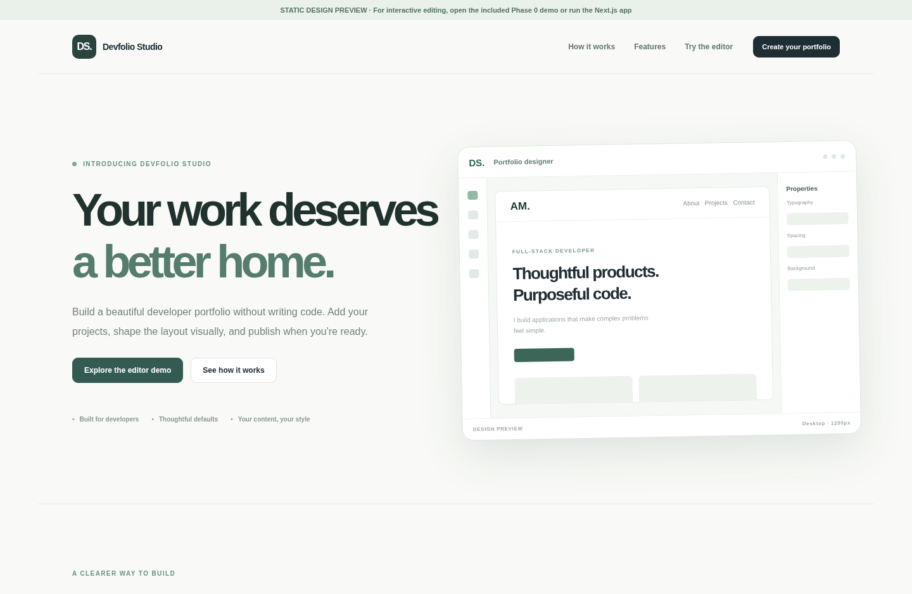
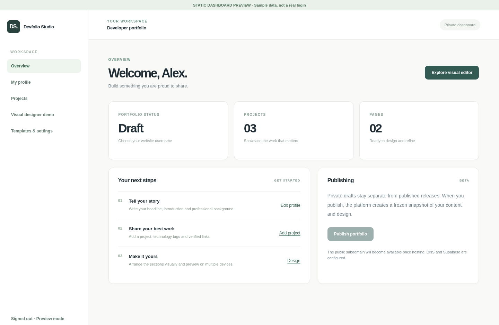
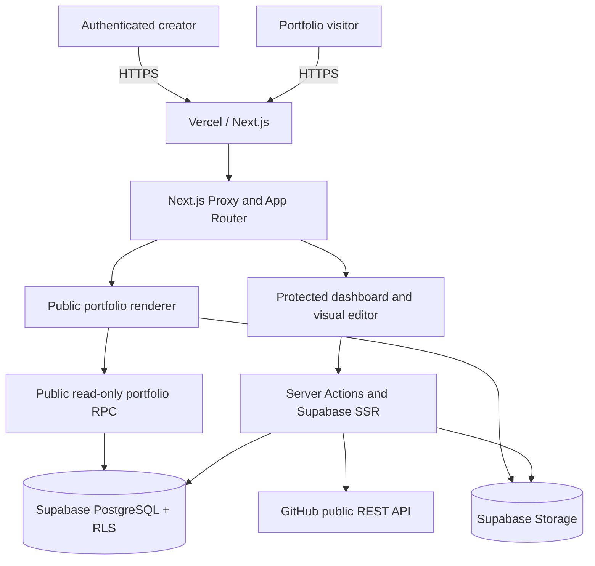
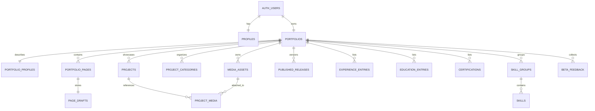
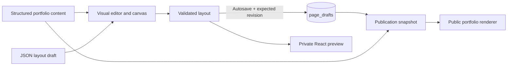
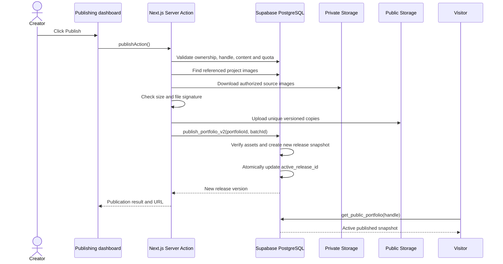

<div align="center">

# Devfolio Studio

### A no-code, multi-tenant portfolio builder designed for developers

**Build your profile. Showcase real projects. Design visually. Publish with confidence.**

[](https://nextjs.org/)
[](https://react.dev/)
[](https://www.typescriptlang.org/)
[](https://supabase.com/)
[](https://vercel.com/)

**[Live staging application](https://devfolio-staging.vercel.app)** · **[Try the visual editor](https://devfolio-staging.vercel.app/demo)** · **[Repository](https://github.com/Vaibhav-153/devfolio-studio)**

</div>

> **Project status:** Devfolio Studio v0.6.0 has a working Next.js build, a Vercel-hosted staging deployment, five Supabase migrations, and automated tests. Staging deployment is **not the same as a fully audited public production launch**. Authentication, cross-account security, SMTP, wildcard DNS, backups, and operational monitoring should be verified before accepting unrestricted users.

---

## Table of contents

1. [Project overview](#1-project-overview)
2. [Problem statement and motivation](#2-problem-statement-and-motivation)
3. [Proposed solution and objectives](#3-proposed-solution-and-objectives)
4. [Who it is for](#4-who-it-is-for)
5. [Features](#5-features)
6. [End-to-end user journey](#6-end-to-end-user-journey)
7. [Application screenshots](#7-application-screenshots)
8. [Technology stack and why it was chosen](#8-technology-stack-and-why-it-was-chosen)
9. [System architecture](#9-system-architecture)
10. [Database design and multi-tenancy](#10-database-design-and-multi-tenancy)
11. [Visual editor architecture](#11-visual-editor-architecture)
12. [Publishing, releases, and rollback](#12-publishing-releases-and-rollback)
13. [Public routing and custom domains](#13-public-routing-and-custom-domains)
14. [Authentication and security design](#14-authentication-and-security-design)
15. [Project directory structure](#15-project-directory-structure)
16. [Run locally](#16-run-locally)
17. [Supabase database setup](#17-supabase-database-setup)
18. [Vercel deployment and environment variables](#18-vercel-deployment-and-environment-variables)
19. [Testing and quality assurance](#19-testing-and-quality-assurance)
20. [CI/CD and operations](#20-cicd-and-operations)
21. [Design decisions and trade-offs](#21-design-decisions-and-trade-offs)
22. [Current limitations and future scope](#22-current-limitations-and-future-scope)
23. [Development roadmap](#23-development-roadmap)
24. [Frequently asked questions](#24-frequently-asked-questions)
25. [How to explain the project](#25-how-to-explain-the-project)
26. [Contributing, security, and license](#26-contributing-security-and-license)

---

## 1. Project overview

**Devfolio Studio** is a web-based Software-as-a-Service (SaaS) application that allows developers and other technical professionals to build and publish a personal portfolio **without hand-coding the portfolio website**.

A user creates an account, adds structured information about their work, chooses a portfolio style, edits the layout in a responsive visual builder, previews changes privately, and publishes a public website. Later updates are kept as drafts until the user deliberately publishes another version.

Unlike a simple portfolio template or static website, the system combines:

- **Content management:** profiles, projects, project case studies, screenshots, categories, experience, education, certifications, and skills.
- **Visual website creation:** section-based editing plus bounded freeform element positioning, with device-specific layouts.
- **Hosted publishing:** published portfolio pages generated from versioned snapshots rather than directly from mutable drafts.
- **Multi-user architecture:** separate accounts and portfolios, backed by PostgreSQL Row Level Security (RLS).
- **Release management:** publication history, restore-as-new-version, and unpublishing.

**Current application version:** `0.6.0` (see [`package.json`](package.json)).

## 2. Problem statement and motivation

### The problem

A strong developer portfolio is useful for job applications, freelance work, internships, technical networking, and demonstrating practical skills. However, building and maintaining a polished portfolio can be surprisingly difficult:

| Challenge | Effect on users |
| --- | --- |
| Writing an entire site from scratch | Requires frontend, deployment, styling, and hosting knowledge even when the user only wants to present their work. |
| Generic website builders | May not have developer-focused concepts such as repository links, technology stacks, or detailed project case studies. |
| Repeating content across templates | Changing design can mean copying projects and rewriting information. |
| Responsiveness | Desktop layouts may break on phones if elements have no mobile-specific controls. |
| Risky updates | Editing the live website can expose unfinished content or accidental layout changes. |
| Publishing complexity | Domains, DNS, authentication, hosting, databases, and image storage are separate concerns for beginners. |

### Why this project was selected

Devfolio Studio addresses a realistic, developer-focused problem while demonstrating the engineering challenges of a modern SaaS product: **authentication, multi-tenancy, database design, visual editing, file storage, transactional publishing, deployment, and security**.

The objective is not merely to create another portfolio webpage. It is to **build the platform that other people use to create their own portfolios**.

## 3. Proposed solution and objectives

The product follows a simple workflow:

**Create an account → Add content → Choose a style → Edit visually → Preview → Publish → Improve and republish.**

### Product objectives

1. **Reduce technical barriers:** let users build a credible site without manually editing HTML, CSS, or deployment configuration.
2. **Make content reusable:** keep career/project information in structured records independent of page layout.
3. **Support creative control:** allow section reordering, property editing, and responsive freeform positioning.
4. **Protect unfinished work:** save private drafts separately from public releases.
5. **Support multiple independent users:** enforce account ownership in the database, not just in the UI.
6. **Enable reliable releases:** keep historical snapshots so users can republish or restore earlier versions.
7. **Provide an extensible foundation:** use a typed full-stack application with migrations, tests, and deployable hosting.

### What makes Devfolio Studio different

- Developer-specific project fields and public GitHub repository preview/import assistance.
- Three curated template directions, not an unrestricted design canvas with no defaults.
- **B1 responsive freeform editing:** flexible positioning **inside bounded sections** instead of uncontrolled page-wide absolute positioning.
- One content source reused across different templates and layouts.
- Publication snapshots with controlled media promotion and release history.
- Private editing dashboard and public read-only website within one Next.js application.

## 4. Who it is for

The primary audience includes **students, junior developers, software engineers, full-stack developers, frontend/backend developers, data/AI practitioners, and freelancers** who need a professional way to showcase work.

Typical use cases:

- A student publishes projects, skills, and certificates for internship applications.
- A developer turns public GitHub repositories into richer, human-readable project stories.
- A freelancer shares selected work with a prospective client.
- A professional updates projects privately before releasing a new version of their portfolio.

**Scope of Release 1:** one portfolio per account, with a fixed set of approved layout components and no arbitrary custom JavaScript execution.

## 5. Features

### 5.1 Account and workspace

- Email/password signup, login, logout, email confirmation, and password recovery through Supabase Auth.
- Authenticated dashboard, account-owned settings, and guided portfolio completion.
- Automatic initial portfolio/profile/page creation through a PostgreSQL signup trigger.

### 5.2 Structured portfolio content

| Area | Supported data and actions |
| --- | --- |
| Profile | Name, role, headline, introduction, biography, email, GitHub/LinkedIn URLs, skills. |
| Projects | Title, slug, category, summary, technology tags, repository/demo links, problem, solution, contribution, outcome, visibility, featured status, ordering. |
| Categories | Create and manage reusable project categories. |
| Media Library | Upload/manage PNG, JPEG, WebP, and PDF files; attach images to projects. |
| Project gallery | Image ordering, alternative text, captions, and cover-image selection. |
| Career | Work experience and education entries. |
| Certifications | Credential details, issuer, issue date, and verification URL. |
| Skills | Grouped technical skills and tools. |
| GitHub assist | Preview metadata and optional README excerpt from a **public** GitHub repository before reviewing and saving a project. |

The GitHub feature suggests editable draft information; it does **not** automatically publish a repository as a verified case study or read private repositories.

### 5.3 Visual website builder

- Add, reorder, duplicate, hide, and customize supported sections.
- Section types: `Hero`, `ProjectGrid`, `About`, `Skills`, `Text`, `Image`, `Contact`, `Freeform`, `Experience`, `Education`, and `Certifications`.
- Desktop, tablet, and mobile viewport modes.
- Freeform `note`, `label`, `button`, and `image` elements with drag-and-resize interactions.
- Independent element geometry for each device; layers, lock/hide controls, snapping, keyboard nudging, undo/redo, and preview mode.
- Draft autosave with revision checking; offline demo uses browser-local storage.
- Validated JSON import/export in the **local demo**, rather than an unrestricted production import endpoint.

### 5.4 Curated templates

| Internal identifier | Display name | Design direction |
| --- | --- | --- |
| `minimal` | **Signature Minimal** | Clean, editorial, restrained presentation. |
| `midnight` | **Midnight Developer** | Dark, technical aesthetic. |
| `grid` | **Grid Studio** | Structured, project-first visual layout. |

Switching templates changes the presentation while keeping structured project/profile data separate.

### 5.5 Publishing and public portfolio

- Private draft preview; manual publish and unpublish.
- Public home/projects pages and individual project case studies.
- Immutable historical release snapshots and restoration to an earlier snapshot **as a new version**.
- Public project images promoted to versioned storage paths before activating a release.
- Public-page metadata, canonical URLs, Open Graph data, and sitemap/robots endpoints.
- Per-account publication throttling and a private beta-feedback area.

## 6. End-to-end user journey

1. **Register.** Supabase Auth creates an account. The signup database trigger creates the user's initial portfolio and starter pages.
2. **Complete the profile.** Enter professional identity, links, and about information.
3. **Add projects and career records.** Projects are saved independently of their visual presentation; optionally preview a public GitHub repository.
4. **Upload media.** Files enter an owner-scoped **private draft** storage bucket, and project images can be ordered and assigned a cover.
5. **Select a design.** Choose one of the three curated portfolio themes.
6. **Edit pages.** Use the visual editor to manage sections and adjust desktop/tablet/mobile layouts. Drafts autosave with revision checks.
7. **Preview privately.** Review unpublished changes without affecting the currently public website.
8. **Publish.** The backend validates required content, prepares public assets, creates a versioned release, and activates it.
9. **Share.** Visitors view the active public snapshot; they do not receive dashboard or draft access.
10. **Update safely.** Keep editing drafts, publish another version, restore an earlier version, or unpublish the site.

## 7. Application screenshots

The repository includes illustrative UI screenshots and standalone previews:

### Landing page



### User dashboard



### Try the editor

Use [`/demo`](https://devfolio-staging.vercel.app/demo) for the in-app editor demonstration. The repository also includes browser-only phase demos under `preview-phase2/` through `preview-phase6/`; these illustrate UI behavior **without connecting to the live Supabase database**.

> The images in `preview/` are project screenshots. They illustrate the design rather than serve as evidence of current production uptime or a security audit.

## 8. Technology stack and why it was chosen

| Layer | Technology | Role / reason for choosing it |
| --- | --- | --- |
| Frontend | **React 19** | Component-driven, interactive dashboard and visual editor. |
| Framework | **Next.js 16 (App Router)** | File-based routing, server rendering, server actions, metadata, and a single full-stack deployment. |
| Language | **TypeScript 5** | Stronger contracts for portfolio content, editor layouts, and server-side interfaces. |
| Styling | **Custom CSS** (`app/globals.css`) | Fine-grained control of the marketing site, dashboard, editor, and responsive visual identity. |
| Authentication | **Supabase Auth** | Managed email/password identities, sessions, confirmation, and recovery. |
| Database | **Supabase PostgreSQL** | Relational content, data constraints, transactions, RLS, version history, and stored procedures. |
| File storage | **Supabase Storage** | Owner-private draft files and separately promoted public images. |
| Supabase integration | `@supabase/supabase-js`, `@supabase/ssr` | Database/API client and cookie-based server/browser sessions. |
| Backend operations | **Next.js Server Actions + PostgreSQL RPCs** | Authenticated mutations plus database-atomic updates where necessary. |
| Hosting | **Vercel** | Managed Next.js hosting, environment variables, deployment previews, HTTPS and domain configuration. |
| Source control | **Git + GitHub** | Version history, collaboration, code reviews, and automated workflows. |
| CI | **GitHub Actions** | Automated linting, TypeScript checks, tests, builds, and dependency auditing. |
| Test tooling | **Node.js test runner, ESLint, TypeScript, Python/Playwright scripts** | Unit/contract checks and local browser simulations; hosted staging tests are separate. |

**Intentional decision:** The editor is a **custom React implementation**. Puck was evaluated conceptually but **is not a dependency or an integrated editor** in the current source. See [`docs/PUCK_DECISION.md`](docs/PUCK_DECISION.md).

### Why this stack rather than building everything manually?

- **Next.js** combines the public site, authenticated dashboard, server actions, and portfolio routes in one repository.
- **Supabase** reduces the time spent writing and operating custom authentication, storage, and database APIs; PostgreSQL still allows explicit data-integrity rules.
- **TypeScript** reduces accidental mismatches between editor state, saved JSON layouts, and published snapshots.
- **Vercel** simplifies the application hosting lifecycle so development can focus on the portfolio-building experience.
- **Custom React editing** provides exact control over bounded freeform positioning and per-device overrides without adding an unvalidated visual-editor framework.

## 9. System architecture

### High-level architecture



### Architectural layers

| Layer | Main responsibility | Where to find it |
| --- | --- | --- |
| Presentation | Pages, dashboard forms, portfolio rendering, visual design tools. | `app/`, `components/`, `app/globals.css` |
| Authentication | Browser/server Supabase clients, cookie refresh, protected pages. | `lib/auth.ts`, `lib/supabase/`, `app/auth/`, `proxy.ts` |
| Domain logic | Validation, content models, editor operations, template compositions. | `lib/models.ts`, `lib/content.ts`, `lib/validation.ts`, `lib/editor-ops.ts` |
| Application mutations | Save profile/projects/layout, upload media, publish, restore, unpublish, feedback. | `actions/` |
| Publishing engine | Validate media, copy public assets, hydrate published image paths, generate URLs. | `lib/publishing/` |
| Persistence | Portfolio tables, foreign keys, RLS, SQL functions, release and quota triggers. | `supabase/migrations/` |
| Public delivery | Public handle routes, project case studies, SEO/sitemap/robots. | `app/p/`, `components/portfolio/` |
| Quality/operations | Tests, readiness probes, CI, staging checks, runbook. | `tests/`, `scripts/`, `.github/workflows/`, `docs/` |

The application is a **modular monolith**: one deployable Next.js application, with clearly separated modules and a managed PostgreSQL backend. This is a deliberate simplification for an early-stage SaaS, not a microservices architecture.

## 10. Database design and multi-tenancy

### Main entities



`AUTH_USERS` represents Supabase's `auth.users` table. The remaining names correspond to application tables under the PostgreSQL `public` schema.

### Important tables

| Table | Purpose |
| --- | --- |
| `profiles` | Account-level profile information. |
| `portfolios` | Portfolio owner, unique handle, template, status, and active release pointer. |
| `portfolio_profiles` | Displayed personal and professional biography content. |
| `portfolio_pages` | Page definitions and ordering. |
| `page_drafts` | Editable JSON layout and optimistic-lock revision. |
| `projects` / `project_categories` | Portfolio projects and reusable categories. |
| `media_assets` / `project_media` | File metadata, image attachments, ordering, captions, and covers. |
| `experience_entries`, `education_entries`, `certifications` | Career history and credentials. |
| `skill_groups`, `skills` | Structured, grouped skills. |
| `published_releases` | Version-numbered published JSON snapshots. |
| `audit_events` | Selected publication and release lifecycle events. |
| `github_import_events` | GitHub import usage tracking. |
| `beta_feedback` | Account-owned bug reports, usability feedback, and suggestions. |

### Multi-tenant ownership model

- Each account owns **one** portfolio in the current release (`portfolios.owner_id` is unique).
- Portfolio IDs link projects, pages, media, releases, and structured content to the same owner.
- PostgreSQL **Row Level Security (RLS)** limits authenticated access to rows belonging to the current user.
- Composite keys, foreign keys, unique constraints, and server validation prevent cross-portfolio references and invalid records.
- User-owned draft records are **not** exposed through the anonymous public data API.
- Public access is intentionally narrow: the `get_public_portfolio(handle)` RPC returns the **active published snapshot**, or no result if the portfolio is unpublished/missing.

### Draft concurrency control

`page_drafts` stores a `revision` integer. Saving uses the `save_page_draft` RPC with an **expected revision**; if another browser tab has already changed the draft, the update is rejected instead of silently overwriting newer work.

## 11. Visual editor architecture

### Separation of content and layout

A core design decision is to store **what a portfolio says** separately from **how it looks**:

- **Content records:** the creator's name, projects, technologies, experience, etc., stored relationally.
- **Layout document:** ordered, allowlisted UI sections with approved properties and responsive styles, stored as JSONB in `page_drafts`.
- **Renderer:** shared React components render that content and layout both in previews and on published pages.

A simplified layout document looks like this:

```json
{
  "schemaVersion": 1,
  "blocks": [
    {
      "id": "hero",
      "type": "Hero",
      "props": {},
      "style": {
        "surface": "plain",
        "paddingY": 58
      }
    },
    {
      "id": "projects",
      "type": "ProjectGrid",
      "props": {
        "title": "Selected work",
        "columns": 2,
        "maxProjects": 6
      },
      "style": {
        "surface": "soft",
        "paddingY": 58
      }
    }
  ]
}
```

### Responsive freeform design

Freeform elements use bounded percentage-based positions (`x`, `y`, `w`, `h`) with **separate desktop, tablet, and mobile values**. The editor can snap movements to a grid and constrain elements to remain inside the relevant section.

This avoids two extremes: a rigid template where nothing can be moved, and a completely unrestricted canvas that becomes difficult to keep responsive.

### Editor data flow



**Implementation detail:** Layouts and URLs pass through validation in `lib/validation.ts`, and approved blocks are rendered by `components/portfolio/PortfolioRenderer.tsx`. Users cannot inject arbitrary HTML, JavaScript, or new server-side component types through the visual editor.

## 12. Publishing, releases, and rollback

Publishing is the central reliability feature. **Editing is not the same as publishing.**

### Publication lifecycle



### Why release snapshots?

If public pages read directly from editable records, a partially edited project or layout could instantly appear online. Instead:

- Drafts remain private until an explicit publish action.
- The database builds the release from the authenticated owner's data, rather than trusting a client-submitted public snapshot.
- `published_releases` retains versioned history; `portfolios.active_release_id` selects the currently live version.
- A restore operation **copies an older snapshot into a new release**, preserving history and leaving the current private draft alone.
- Unpublishing disables public page access without deleting drafts or release history.

### Media safety

- Draft uploads go to `portfolio-drafts` (**private**).
- Published project images are copied to `portfolio-public` (**public**) under namespaced, version-specific paths.
- The publication action verifies file size and basic file signatures before promoting referenced images.
- Database publication checks that all required public objects exist before switching the active release.
- A failed publication should leave the previously active release intact.

**Important:** Unpublishing a website does not instantly erase previously public/cached image URLs. Older releases may still reference those images, so media cleanup must be handled carefully.

### Built-in beta limits

Limits currently enforced in code/database include:

- Up to **5 releases per portfolio in 10 minutes**.
- Up to **24 distinct public project images per release**.
- Up to **12 images per project gallery**.
- Up to **5 MiB per uploaded file**.

These are intentional early-beta safeguards, not long-term product pricing tiers.

## 13. Public routing and custom domains

The same Next.js application serves both the **builder** and the **published portfolios**.

| Host/path | Meaning |
| --- | --- |
| `/` | Devfolio Studio landing page. |
| `/signup`, `/login`, `/reset-password` | Authentication flows. |
| `/dashboard/...` | Owner-only portfolio management. |
| `/studio/home` and `/studio/projects` | Authenticated visual editor. |
| `/preview/...` | Authenticated draft preview. |
| `/p/{handle}` | Public portfolio route (also useful for shared-domain staging). |
| `/p/{handle}/projects/{slug}` | Public project case study. |
| `{handle}.yourdomain.com` | Intended portfolio URL once custom wildcard DNS is configured. |

The Next.js `proxy.ts` checks hostnames against the configured root domain. With a properly configured custom wildcard domain, valid user subdomains are internally rewritten to `/p/{handle}`; invalid child hosts are rejected. Dashboard, editor, and authentication routes are not exposed on tenant hosts.

**Shared Vercel staging domain:** Vercel's shared `vercel.app` hostname is not an arbitrary wildcard domain for customer sites. The staging URL helper uses `/p/{handle}` for such deployments. A registered custom domain and wildcard DNS/TLS configuration are required for `handle.yourdomain.com` URLs.

The public portfolio also has route-specific metadata and generated sitemap/robots responses in `app/p/`.

## 14. Authentication and security design

Security must be enforced on the **server and database**, not only by hiding buttons in React.

| Threat or concern | Implementation approach |
| --- | --- |
| Unauthorized dashboard access | Protected routes use Supabase user claims; unauthenticated users are redirected. |
| Session handling | `@supabase/ssr` provides browser/server clients; Next.js Proxy refreshes authentication cookies. |
| Cross-account data reads/writes | Owner-scoped queries, PostgreSQL RLS, constraints, and ownership checks inside sensitive SQL RPCs. |
| Forged publishing requests | Authenticated server actions call owner-checked publication functions. |
| Draft leaks | Draft layouts and uploads are private; anonymous portfolio readers receive only published snapshots. |
| Unsafe links and layouts | Allowlisted blocks, text limits, and HTTP(S) URL validation. |
| Unsafe GitHub import endpoints | Strictly accepts public `https://github.com/owner/repo` URLs; requests the known GitHub API endpoint. |
| Secret-key exposure | Elevated Supabase credentials belong only in server runtime variables, never `NEXT_PUBLIC_*`. |
| Publication abuse | Database-enforced release quotas; GitHub import and beta-feedback throttling. |
| Browser security | Security headers, frame denial, MIME sniff protection, referrer policy, and **report-only** CSP. |
| Incident diagnostics | Minimal structured operational events without raw secrets or layout data. |

### Important security boundaries

- **`NEXT_PUBLIC_*` variables are public by design.** Put only browser-safe information in them.
- **`SUPABASE_SERVICE_ROLE_KEY` is a private server credential.** Never put it in GitHub, browser code, screenshots, or a public issue.
- The Content Security Policy is currently **report-only**; it is not yet an enforced browser security policy.
- Built-in security measures do **not** replace real two-account RLS/Storage tests, spam protection, security review, backups, or monitoring.
- For security details and testing expectations, see [`docs/PHASE5_SECURITY_REVIEW.md`](docs/PHASE5_SECURITY_REVIEW.md) and [`docs/SECURITY.md`](docs/SECURITY.md).

## 15. Project directory structure

```text
.
├── .github/
│   ├── workflows/                 # CI, hosted smoke tests, staging security checks
│   └── ISSUE_TEMPLATE/            # Bug report template
├── actions/
│   ├── portfolio.ts               # Profile, projects, settings, draft saves
│   ├── content.ts                 # Media, categories, careers, skills
│   ├── publishing.ts              # Publish, unpublish, restore
│   ├── github.ts                  # Public GitHub repository preview
│   └── feedback.ts                # Account-owned beta reports
├── app/
│   ├── dashboard/                 # Protected application workspace
│   ├── studio/[pageKey]/          # Visual editor
│   ├── preview/                   # Draft preview pages
│   ├── p/[handle]/                # Published portfolio and project routes
│   ├── auth/callback/             # Supabase auth callback
│   ├── health/                    # Liveness and readiness routes
│   ├── login/, signup/            # Account screens
│   └── globals.css               # Shared styling and responsive layouts
├── components/
│   ├── auth/                      # Auth UI
│   ├── dashboard/                 # Dashboard forms, media, career, skills
│   ├── studio/                    # Custom visual designer
│   ├── portfolio/                 # Public / preview portfolio renderer
│   └── publishing/                # Release history controls
├── lib/
│   ├── supabase/                  # SSR/browser clients and auth refresh
│   ├── publishing/                # Public media, snapshots and URL helpers
│   ├── models.ts                  # Typed content and layout contracts
│   ├── validation.ts              # Layout, snapshot and URL validation
│   ├── editor-ops.ts              # Editor positioning / section operations
│   └── host.ts                    # Tenant subdomain validation
├── supabase/migrations/           # Five ordered PostgreSQL migrations
├── scripts/                       # Deployment preflight, hosted and staging probes
├── tests/                         # Unit, contract, security and browser tests
├── docs/                          # Deployment guides, security reviews, runbooks
├── preview/                       # Project screenshots
├── preview-phase2/ ... phase6/     # Standalone local UI demonstrations
├── proxy.ts                       # Next.js tenant routing + auth session refresh
├── next.config.ts                 # Next.js configuration and security headers
├── package.json                   # Dependencies and scripts
├── .env.example                   # Environment variable template (no secrets)
└── README.md
```

## 16. Run locally

### Prerequisites

- **Node.js** compatible with the version in `package.json` (minimum `20.9`; CI uses **Node 22**). Node 22 LTS is a good baseline for reproducible development.
- **npm** and **Git**.
- A Supabase project with the database migrations applied.
- Optionally: the **Supabase CLI** for migrations, and Python 3/browser-test dependencies for additional local test suites.

### 1. Clone the repository

```bash
git clone https://github.com/Vaibhav-153/devfolio-studio.git
cd devfolio-studio
```

For a private repository, authenticate with an account authorized to access it.

### 2. Install dependencies

```bash
npm ci
```

Use `npm install` when initially generating/updating a lockfile; commit the reviewed `package-lock.json`. Prefer `npm ci` for reproducible builds and CI.

### 3. Create local environment configuration

**Windows Command Prompt:**

```bat
copy .env.example .env.local
```

**macOS / Linux:**

```bash
cp .env.example .env.local
```

Set the following values in `.env.local`:

```dotenv
NEXT_PUBLIC_SUPABASE_URL=https://YOUR_PROJECT_REF.supabase.co
NEXT_PUBLIC_SUPABASE_PUBLISHABLE_KEY=YOUR_SUPABASE_PUBLISHABLE_KEY
SUPABASE_SERVICE_ROLE_KEY=YOUR_SERVER_ONLY_SUPABASE_SECRET
NEXT_PUBLIC_ROOT_DOMAIN=localhost
NEXT_PUBLIC_APP_URL=http://localhost:3000
```

**Never commit `.env.local`.** The publishable key and project URL are browser-safe; the service-role/secret key is not.

### 4. Start the development server

```bash
npm run dev
```

Open:

- App: **http://localhost:3000**
- Local editor demo: **http://localhost:3000/demo**
- Signup: **http://localhost:3000/signup**
- Health: **http://localhost:3000/health**

The editor demo can be explored without authenticating, but real account data requires a properly configured Supabase project.

## 17. Supabase database setup

Use a **separate staging project** while testing SQL, access policies, and destructive test scripts.

### Database migrations (apply in order)

| Version | File | Main purpose |
| --- | --- | --- |
| `202610310001` | `202610310001_initial.sql` | Accounts/portfolios, drafts, projects, releases, RLS, private storage, and initial RPCs. |
| `202610310002` | `202610310002_content_management.sql` | Categories, project images, career/skills data, GitHub import support. |
| `202610310003` | `202610310003_publishing.sql` | Public image promotion contract, verified release activation, rollback, public storage. |
| `202610310004` | `202610310004_production_hardening.sql` | Database release rate limiting. |
| `202610310005` | `202610310005_beta_feedback.sql` | Account-owned feedback with RLS and throttling. |

### Apply with Supabase CLI

```bash
npx supabase login
npx supabase link --project-ref YOUR_20_CHARACTER_PROJECT_REF
npx supabase migration list --linked
npx supabase db push --dry-run --linked
npx supabase db push --linked
npx supabase migration list --linked
```

If the project has no `supabase/config.toml` yet, run `npx supabase init` once before linking. **Use the 20-character project reference, not the full `.supabase.co` URL.**

Verify local/remote migration versions match and confirm the `portfolio-drafts` (private) and `portfolio-public` (public) storage buckets exist.

**Warning:** Do not use `supabase db reset --linked` on a database containing user data. Migration application and any destructive staging tests require the correct target environment.

### Supabase Auth URL configuration

Under **Supabase Dashboard → Authentication → URL Configuration**, configure:

- **Site URL:** exact deployed application origin, e.g. `https://devfolio-staging.vercel.app`.
- **Allowed redirect:** `https://devfolio-staging.vercel.app/auth/callback`.
- **Password recovery callback:** allow the same callback with the supported `next=/reset-password` query, following Supabase's redirect-URL rules.
- Include `http://localhost:3000/auth/callback` for local development if required.

Review confirmation email delivery and configure production SMTP before inviting real public users.

## 18. Vercel deployment and environment variables

1. Push the complete source and reviewed `package-lock.json` to GitHub.
2. Import the repository into a Vercel project with **Next.js** as the framework and repository root `./`.
3. Add the correct Supabase and domain variables for that deployment environment.
4. Deploy, review the build logs, and confirm the deployment is **Ready**.
5. Test the health/readiness endpoints, authentication, editing, and publishing.
6. Redeploy after changing environment variables; existing builds do not automatically absorb new values.

### Required Vercel environment variables

| Name | Example value for this staging deployment | Exposure |
| --- | --- | --- |
| `NEXT_PUBLIC_SUPABASE_URL` | `https://YOUR_PROJECT_REF.supabase.co` | Browser-safe / Config |
| `NEXT_PUBLIC_SUPABASE_PUBLISHABLE_KEY` | Supabase publishable key | Browser-safe / Config |
| `SUPABASE_SERVICE_ROLE_KEY` | Supabase service-role/secret key | **Server-only / Secret** |
| `NEXT_PUBLIC_ROOT_DOMAIN` | `devfolio-staging.vercel.app` | Browser-safe / Config |
| `NEXT_PUBLIC_APP_URL` | `https://devfolio-staging.vercel.app` | Browser-safe / Config |

For a production custom domain, replace the final two values with the exact registered root domain and application origin. The `NEXT_PUBLIC_` prefix is intentional for values that the client is allowed to read.

**Do not commit or post actual secret values.** Keep staging and production credentials isolated.

### Live endpoints

| URL | Expected behavior |
| --- | --- |
| [`/`](https://devfolio-staging.vercel.app/) | Landing page. |
| [`/demo`](https://devfolio-staging.vercel.app/demo) | Local example editor. |
| [`/signup`](https://devfolio-staging.vercel.app/signup) | Signup form. |
| [`/health`](https://devfolio-staging.vercel.app/health) | JSON response with `status: "ok"`; application liveness only. |
| [`/health/ready`](https://devfolio-staging.vercel.app/health/ready) | `status: "ready"` with HTTP 200 if required configuration and public-safe DB probe succeed; otherwise HTTP 503. |

A **Ready** Vercel build does not by itself prove that real signup emails, RLS, Storage uploads, or publishing work; verify them separately.

## 19. Testing and quality assurance

### Key commands

```bash
npm run lint                  # ESLint
npm run typecheck             # TypeScript no-emit check
npm run build                 # Optimized Next.js production build
npm run test:phase6           # Phase 6 Node.js tests
npm run verify:phase6         # Prior phase checks + Phase 6 tests (Python 3 needed)
npm run preflight:staging     # Configuration/source preflight, not a live audit
npm run smoke:release         # Read-only deployed HTTP checks (requires env URL)
```

Other available scripts include `test:unit`, `test:content`, `test:phase3`, `test:phase4`, `test:phase5`, `test:syntax`, and browser scripts under `tests/`.

### Verified local Windows build (October 31, 2026)

The following results were reported from the actual local application build:

| Check | Result |
| --- | --- |
| `npm run build` | **Passed**: Next.js 16.4.3 compiled successfully and generated app routes. |
| `npm run test:phase6` | **18 passed, 0 failed**. |
| `npm run lint` | **0 errors, 16 warnings**. |
| TypeScript during build | **Passed**. |
| Supabase migrations | **Five matching local/remote versions** confirmed. |
| Vercel deployment | **Ready** at the staging hostname. |

These are **point-in-time results**, not a guarantee that every subsequent commit or live multi-user operation has passed. The 16 lint warnings, dependency advisories, and real integration/security acceptance tests should be reviewed before a broad launch.

### Staging acceptance checklist

- [ ] Sign up, confirm an email, log out, log back in, and reset the password.
- [ ] Create two independent test accounts; verify neither can read or modify the other's projects, drafts, media, releases, or feedback.
- [ ] Save profile, skills, career information, and a project with screenshots.
- [ ] Test desktop, tablet, and mobile editor layouts; refresh to verify persistence.
- [ ] Publish a portfolio; verify public pages, case studies, and images.
- [ ] Edit a draft; verify the live site remains unchanged until a new release.
- [ ] Restore an older release and verify that history is retained.
- [ ] Unpublish and confirm public pages no longer render.
- [ ] Test invalid subdomains and blocked dashboard routes on tenant hosts.
- [ ] Verify SMTP delivery, monitoring, backup restoration, and administrator access controls.

The destructive two-account script, `scripts/staging-smoke.mjs`, **must only run against a disposable staging Supabase project**. It includes explicit opt-in and matching-project-reference guards. Never run it on production customer data.

## 20. CI/CD and operations

### GitHub Actions workflows

| Workflow | File | Purpose |
| --- | --- | --- |
| Quality gates | [`.github/workflows/ci.yml`](.github/workflows/ci.yml) | On push/PR: install from lockfile, lint, type-check, phase verification, build, runtime-dependency audit. |
| Deployed-site smoke | [`.github/workflows/deployed-smoke.yml`](.github/workflows/deployed-smoke.yml) | Manually triggered, read-only HTTP checks against an HTTPS staging URL. |
| Staging security | [`.github/workflows/staging-security.yml`](.github/workflows/staging-security.yml) | Manually triggered, explicitly gated temporary-account isolation checks in disposable staging. |

### Operational checks

- `GET /health` tests process liveness.
- `GET /health/ready` checks configuration and a safe database RPC.
- Minimal structured logs record selected publication/readiness failures.
- Supabase migrations version the schema; published releases version public content.
- Rollback of a portfolio is an **application release restore**, not a database disaster-recovery restore.

**Still required for unrestricted production:** reliable transactional email, external uptime/error monitoring and alert routing, tested backups/restores, retention/deletion policies, upstream abuse controls, dependency/security reviews, and an enforced CSP after compatibility testing. See [`docs/OPERATIONS_RUNBOOK.md`](docs/OPERATIONS_RUNBOOK.md).

## 21. Design decisions and trade-offs

| Decision | Why it was made | Trade-off |
| --- | --- | --- |
| Modular Next.js monolith | Faster iteration and shared frontend/backend types. | Requires care when separating public and private routes. |
| Relational content + JSONB layouts | Projects remain structured while layouts stay flexible. | Layout validation and schema versioning are essential. |
| Bounded responsive freeform builder | Enables creativity without completely unbounded positioning. | Complex freeform designs still need deliberate mobile adjustments. |
| Three curated templates | Professional default quality and clear choices. | Fewer styling options than a full design tool. |
| Custom editor instead of immediate Puck integration | Exact control over responsive drag/resize behavior. | More editor interaction code must be maintained in-house. |
| PostgreSQL RLS + server ownership checks | Defense in depth for multi-user isolation. | Policies and RPC privileges require thorough integration tests. |
| Versioned release snapshots | Draft changes do not modify the live site until publication. | Historical records and public media require lifecycle management. |
| Private-to-public media promotion | Prevents expiring signed draft URLs in published pages. | Requires privileged server code and eventual orphan cleanup. |
| Vercel shared staging URLs | Fast staging without immediately purchasing a domain. | Per-user subdomains require a real wildcard-enabled custom domain. |
| Explicit staging vs production environments | Destructive security tests can run without risking customer records. | More configuration and operational discipline. |

## 22. Current limitations and future scope

This is a meaningful full-stack product, but the following are **not** implemented or not yet independently verified as complete public-production capabilities:

- **Custom user-owned domains:** planned beyond the shared platform-root/wildcard model.
- **Unlimited sites per account:** Release 1 supports one portfolio per account.
- **Puck editor integration:** not installed; the app uses the custom React editor.
- **Arbitrary custom HTML/JavaScript:** intentionally unsupported for safety and consistency.
- **Automatic AI-generated case studies:** not implemented; GitHub import is metadata preview with human review.
- **Payments/subscriptions, team collaboration, and OAuth account linking:** not part of the current product scope.
- **Public wildcard subdomains on `vercel.app`:** not supported as arbitrary tenant hostnames; use a custom wildcard domain.
- **Enforced Content Security Policy:** only report-only at present.
- **Complete live security/operations sign-off:** two-account RLS checks, media retention, backup restore, production SMTP, and monitoring require verified execution.
- **Media antivirus and lifecycle cleanup:** additional production safeguards are needed.
- **Lint/performance cleanup:** some non-blocking warnings remain, including native `` optimization opportunities.

Potential future enhancements: accessibility audits, a richer editor component library, more templates, analytics, stronger media processing, custom domains, billing plans, multi-portfolio accounts, team workspaces, and public launch monitoring.

## 23. Development roadmap

Devfolio Studio was developed in iterative phases, each introducing a distinct technical capability:

| Phase | Main focus | Outcome |
| --- | --- | --- |
| **0 — Feasibility** | Editor concept, interaction exploration, responsive visual preview. | Standalone prototype. |
| **1 — Foundation** | Next.js, Supabase Auth, portfolio data model, guarded application routes. | Application skeleton and owner-aware database. |
| **2 — Content management** | Projects, categories, media, experience, education, skills, certifications, GitHub previews. | Structured creator dashboard. |
| **3 — Visual design** | Responsive freeform editing, layers, drag/resize, themes, preview and autosave. | Custom React visual portfolio builder. |
| **4 — Publishing** | Public project pages, media promotion, versioned releases, restore and unpublish. | Controlled public release workflow. |
| **5 — Hardening** | Security headers, release limits, health checks, CI, incident and staging test plans. | Production-readiness foundations. |
| **6 — Deployment/beta** | Deployment preflight, hosted probes, private beta feedback, staging playbook. | GitHub/Vercel/Supabase staging deployment and test infrastructure. |

**Next engineering milestone:** complete repeatable, evidence-backed end-to-end acceptance of authentication, tenant isolation, uploads, release/rollback, wildcard HTTPS, email delivery, and operations before broad public onboarding.

## 24. Frequently asked questions

<details>
<summary><strong>Is this just a portfolio template?</strong></summary>

No. It is a **portfolio-building SaaS**: authenticated creators use a content dashboard and visual editor; public visitors only see the published portfolio output.

</details>

<details>
<summary><strong>Why use Supabase instead of storing everything in localStorage?</strong></summary>

Local storage is fine for a standalone demonstration but not for secure, multi-device, multi-user accounts. Supabase provides authentication, PostgreSQL, transactional data access, owner policies, and persistent file storage.

</details>

<details>
<summary><strong>Does changing the template delete projects?</strong></summary>

No. The data model separates structured project/content records from the visual layout. A layout preset may change the section composition, but portfolio content is not rewritten as template text.

</details>

<details>
<summary><strong>Does autosave immediately change the live website?</strong></summary>

No. Autosave updates the **private draft**. Visitors read the active **published release** until the owner explicitly publishes a new version.

</details>

<details>
<summary><strong>How does rollback work?</strong></summary>

The owner selects an older release. The backend creates a **new** release containing that historical snapshot and activates it, rather than destructively editing old release records.

</details>

<details>
<summary><strong>Can users publish on a custom subdomain?</strong></summary>

Yes, once an appropriate root domain and wildcard DNS/TLS are configured. On the shared Vercel staging hostname, use `/p/{handle}` instead of assuming arbitrary `*.vercel.app` subdomains are available.

</details>

<details>
<summary><strong>Are all images private?</strong></summary>

No. Draft uploads are private. Images deliberately published to a portfolio are copied to a **public** bucket and may remain accessible by URL even after the website is unpublished.

</details>

<details>
<summary><strong>Is the editor built with Puck, Tailwind, or a drag-and-drop SaaS package?</strong></summary>

No. The current editor is written in **React and TypeScript**, with custom CSS and internal editor operations. Puck was considered but not integrated.

</details>

## 25. How to explain the project

### 30-second project introduction

> **Devfolio Studio is a full-stack, multi-tenant SaaS that lets developers create and publish professional portfolios without coding the website.** I built it with Next.js, React, TypeScript, Supabase, PostgreSQL, and Vercel. It has a structured content dashboard, a custom responsive drag-and-drop editor, and a release system that keeps draft changes separate from published portfolios. The architecture uses Row Level Security for account isolation and versioned database snapshots for reliable publishing and rollback.

### Engineering problems demonstrated

- **Frontend engineering:** reusable React components, responsive layouts, drag/resize gestures, editor state and undo/redo.
- **Backend engineering:** server actions, input validation, API integration, database transactions, and owner-only RPCs.
- **Database engineering:** relational modeling, RLS, referential integrity, optimistic concurrency, and JSONB versioned documents.
- **Systems design:** separation of content/layout, private vs public data, multi-tenant routing, immutable release history, and staging-specific URLs.
- **Security:** secret handling, restricted storage, approved URL schemes, throttling, and cross-account authorization boundaries.
- **DevOps:** GitHub Actions, Supabase migrations, Vercel deployments, liveness/readiness endpoints, and staging acceptance testing.

### Most important technical insight

The hardest problem is **not displaying a portfolio template**. It is designing a secure, multi-user workflow where users can independently manage content, visually edit responsive pages, keep unfinished changes private, and publish or restore a consistent public version without leaking another user's data.

## 26. Contributing, security

### Maintainer

GitHub: **[@Vaibhav-153](https://github.com/Vaibhav-153)** · Repository: **[devfolio-studio](https://github.com/Vaibhav-153/devfolio-studio)**

### Contributions and bug reports

Before proposing changes, read the architecture and relevant documents under [`docs/`](docs/). For bugs, use the repository's issue template and include reproduction steps, expected behavior, actual behavior, and relevant non-sensitive logs. Never include passwords, API keys, service-role credentials, or private user data in issues.

### Security reports

Do **not** publicly disclose active vulnerabilities or credentials through a GitHub issue. Contact the repository owner privately through a channel they designate. Rotate any accidentally exposed secrets immediately.

---

<div align="center">

**Devfolio Studio — Your work deserves a better home.**

Built around one idea: **great technical work deserves a portfolio that is easy to create, easy to manage, and safe to publish.**

[Back to top](#devfolio-studio)

</div>
